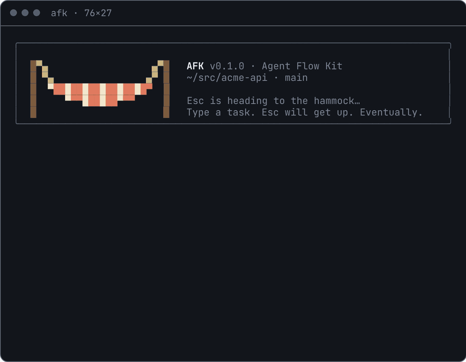
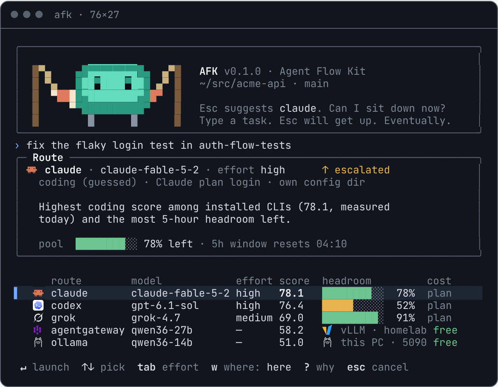
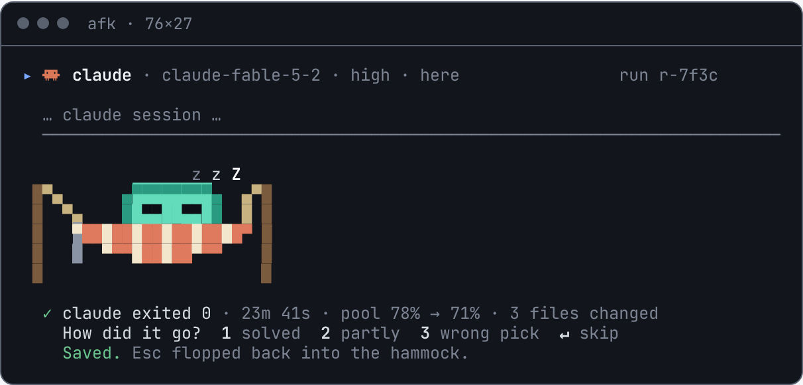
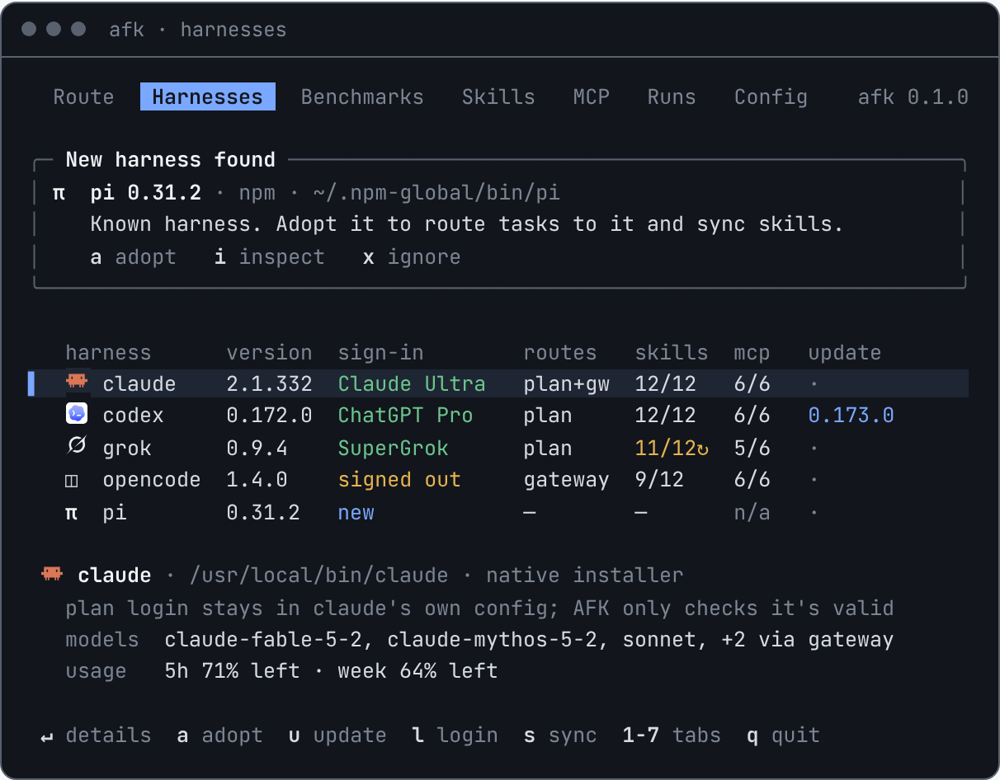
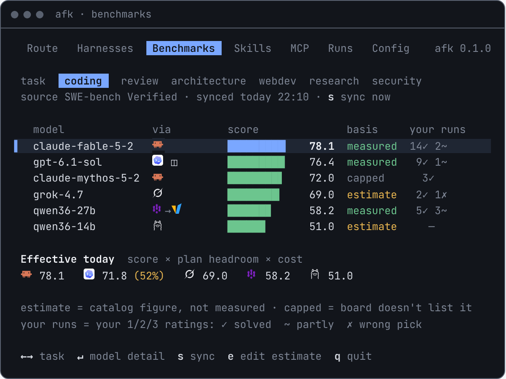
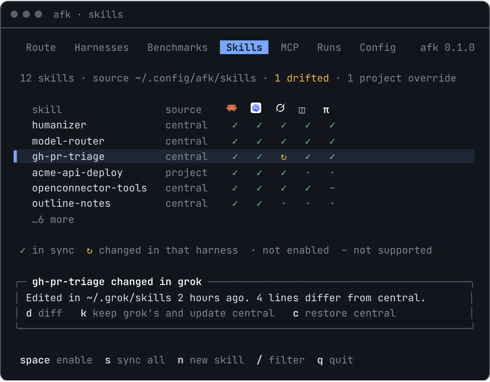
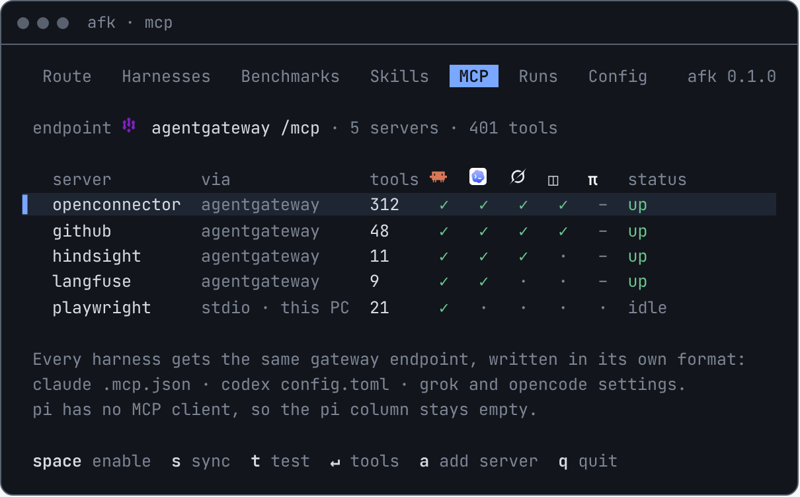
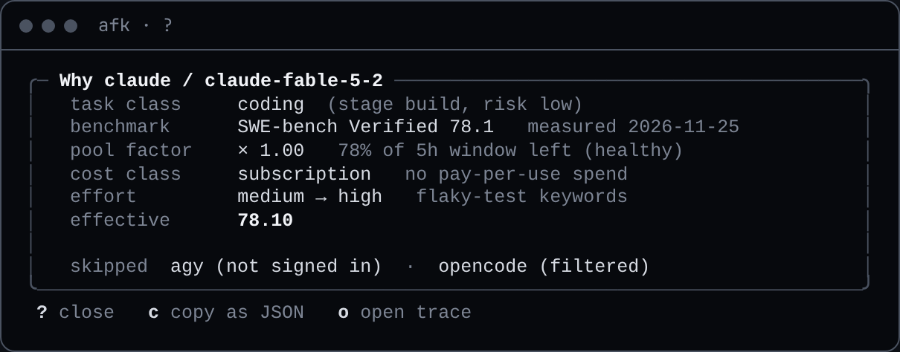

<div align="center">


# AFK

**One command for every coding agent on your machine.**

AFK finds the agent CLIs you have installed (Claude Code, Codex, OpenCode, Grok, Gemini, Copilot and more), picks the best one for the task in front of you, and starts it with the right model and effort.

[Install](#install) · [Quick start](#quick-start) · [How routing works](#how-routing-works) · [Supported CLIs](#supported-clis) · [Roadmap](#roadmap) · [Contributing](#contributing)

</div>

> [!WARNING]
> AFK is pre-release and under active development. The command-line interface and config format may change before 1.0. Packaged installs (`npx`, Homebrew) are not published yet; build from source for now.

<p align="center">
  
</p>

---

## Why AFK

If you pay for more than one AI coding plan, or use a mix of plans, free models and a local gateway, you're choosing between them all day: which CLI, which model, how much effort, and whether that subscription has anything left this window. AFK makes that choice for you, shows you why, and gets out of the way.

- **Routes on evidence.** It weighs each model's benchmark score for the kind of work, how much is left in each subscription pool, and cost. Free and local models win quick tasks; reviews never go to them.
- **Shows its work.** A route card shows the pick, the reason, the pool headroom, and the best option from every other installed CLI before anything starts. You can take it, pick another, or change the effort.
- **Gets out of the way.** The session is the chosen CLI's own interface, with nothing wrapped around it. When it exits, AFK prints a receipt: time, exit status, pool before and after, files changed and commits.
- **Your CLIs, your logins.** AFK routes to whatever you have installed and signed in, and never hands a plan login to a gateway: gateway routes run with a separate config and the gateway's own key.
- **One binary.** AFK is written in Go and is moving to a single static binary with no runtime dependencies.

## Install

### From source (today)

Requires Go 1.26 or newer.

```sh
git clone https://github.com/jlengelbrecht/agent-flow-kit.git
cd agent-flow-kit
CGO_ENABLED=0 go build -o ~/.local/bin/afk ./cmd/afk
```

That's all AFK needs: routing, pool usage, launch plans, one-shot answers (`-p`) and the benchmark sync all run in the Go binary, with no `bash`, `jq` or `yq`.

### Packaged (planned)

```sh
npx agent-flow-kit            # run without installing
npm install -g agent-flow-kit # installs the `afk` command
brew install jlengelbrecht/tap/afk
curl -fsSL https://raw.githubusercontent.com/jlengelbrecht/agent-flow-kit/master/install.sh | sh
```

The npm package will ship prebuilt native binaries for Linux, macOS and Windows, with no postinstall download.

## Quick start

See which agent CLIs AFK found:

```console
$ afk harness
Agent CLIs · 12 of 13 supported CLIs installed

  CLI       VERSION   SIGN-IN        INSTALLED WITH  EFFORT      UPDATE WITH
  claude    2.1.332   authenticated  mise            low..max    mise upgrade
  codex     0.172.0   authenticated  mise            low..ultra  mise upgrade
  opencode  2.4.2     authenticated  mise            low..high   mise upgrade
  ...
```

Start a session. AFK shows the route card, and `↵` launches the pick:

```sh
afk "make the settings page responsive"
```

Ask what it would pick, without starting anything:

```sh
afk --explain "refactor the parser"
afk --explain --json "fix a flaky test"   # machine-readable
```

Get one answer and exit. If the CLI fails to start or hits a sign-in, quota or rate limit, the next best CLI answers:

```sh
afk -p "what does internal/router/select.go do?"
afk -p --task review "review the last commit"
```

### The route card

<p align="center">
  
</p>

| Key | Does |
|---|---|
| `↵` | start the selected route |
| `↑` `↓` / `j` `k` | pick another row |
| `tab` | change the effort, within what that CLI supports |
| `e` | edit the prompt and route again |
| `y` `y` | yolo: the CLI acts without asking for permission (press twice) |
| `?` | why this route: benchmark, pool, cost and effort |
| `esc` | cancel; nothing is started |

`-y` / `--yes` skips the card and starts the router's pick. When the session ends, Esc comes back with a receipt:

<p align="center">
  
</p>

After a session you can rate the pick (`1` solved, `2` partly, `3` wrong pick). Runs are saved to `~/.config/afk/state/runs/`.

### The control panel

AFK is also where you manage your agent CLIs. These full-screen tabs are from the design and are being built now (see the [roadmap](#roadmap)).

<table>
  <tr>
    <td width="50%"><br><sub><b>Harnesses.</b> Every CLI on the machine, its sign-in, updates, and new ones to adopt.</sub></td>
    <td width="50%"><br><sub><b>Benchmarks.</b> What the scores say per task class, and what AFK picks today.</sub></td>
  </tr>
  <tr>
    <td width="50%"><br><sub><b>Skills.</b> One source of skills, synced into each harness's own format.</sub></td>
    <td width="50%"><br><sub><b>MCP.</b> MCP servers and gateways, written into every harness's config.</sub></td>
  </tr>
</table>

## Usage

```
afk [options] [prompt]
afk harness [--all] [--json]
afk bench sync [--json]
```

| Option | Meaning |
|---|---|
| `-p`, `--print` | one-shot answer; the prompt comes from the arguments or stdin |
| `--task <kind>` | `coding` (default), `quick`, `complex`, `review`, `architecture`, `webdev`, `research`, `security`; guessed from the prompt when not given |
| `--prefer <mode>` | `balanced` (default), `cheap` (free and local first), `best` (strongest model for the kind) |
| `--harness <cli>` | use only this CLI |
| `--model <id>` | use this model |
| `--effort <level>` | `low`, `medium`, `high`, or higher where the CLI supports it |
| `--explain`, `--dry-run` | show the decision and the best route per CLI; start nothing |
| `--json` | machine-readable output for `--explain` and `-p` |
| `--yolo` | let the CLI act without asking, using its own skip-permissions flag |
| `--pass <arg>` | pass one argument through to the CLI unchanged (repeatable) |
| `-y`, `--yes` | skip the route card |
| `--` | everything after it is the prompt |

The full reference is in the [command line reference](docs/reference/cli.md); everything else is in the [documentation](docs/README.md).

## How routing works

For each installed CLI, AFK considers every model that CLI can run and scores it on:

1. **Fit for the task.** Public benchmark results for that kind of work (coding, review, architecture, and so on).
2. **Pool headroom.** How much is left in that subscription's window, from the provider's live usage where it reports one (Claude, Codex) and from recent session activity otherwise. A pool that just hit a quota or sign-in error is marked down for a while.
3. **Cost.** Subscription, free, local or metered. `--prefer cheap` favours free and local models; `--prefer best` ignores cost.

Effort starts from the task kind and goes up for harder work, within what the CLI supports. Two rules are fixed: a review never goes to a free or local model, and a plan login is never sent through a gateway.

Press `?` on the route card to see the working:

<p align="center">
  
</p>

## Supported CLIs

| CLI | Command | Discovery | Routing |
|---|---|:---:|:---:|
| Claude Code | `claude` | ✓ | ✓ |
| Codex CLI | `codex` | ✓ | ✓ |
| OpenCode | `opencode` | ✓ | ✓ |
| Grok CLI | `grok` | ✓ | ✓ |
| Antigravity CLI | `agy` | ✓ | ✓ |
| Gemini CLI | `gemini` | ✓ | planned |
| GitHub Copilot CLI | `copilot` | ✓ | planned |
| Cursor Agent | `cursor-agent` | ✓ | planned |
| Kiro CLI | `kiro-cli` | ✓ | planned |
| Qwen Code | `qwen` | ✓ | planned |
| Kimi Code | `kimi` | ✓ | planned |
| Pi | `pi` | ✓ | ✓ |
| Devin CLI | `devin` | ✓ | planned |

Discovery reports each CLI's version, how it was installed (mise, npm, bun, pnpm, Homebrew, uv, pipx, cargo or self-managed), the command that updates it, its effort levels, and whether it looks signed in. The sign-in check looks for a login on disk. For Claude, Codex and a few others it opens the credential file to see which login fields are set, but it never decodes, prints, logs or stores a token's value. A file AFK can't read shows as `unknown`, not signed out. Where AFK can't tell, it says `unknown`.

Adding a CLI means adding one entry to [`internal/harness/registry.go`](internal/harness/registry.go).

## Configuration

Your settings live in `~/.config/afk/config.toml`, managed with `afk config get|set|edit|path|migrate` (`afk config set route.prefer cheap`). Secrets in it are references (`key = "env:LITELLM_KEY"`), never values. `afk config migrate` copies an older `~/.config/afk/router.json` into it. A project's `.afk/config.json` can set only its own routing preferences, never a gateway or a key. Precedence and every key are in the [configuration reference](docs/reference/configuration.md). These environment variables still apply, and win over the file:

| Setting | Purpose |
|---|---|
| `AFK_LITELLM_BASE_URL` | address of a LiteLLM (or other Anthropic-compatible) gateway |
| `AFK_GATEWAY_KEY` / `AFK_GATEWAY_KEY_ENV` | the gateway key, or the name of the variable that holds it |
| `AFK_HARNESS_BIN_DIR` | look for CLIs only in this directory |
| `AFK_SKIP_BENCHMARK_AUTOSYNC=1` | don't refresh the benchmark catalog in the background |
| `NO_COLOR`, `AFK_MOTION=off` | no colour; no animation |

A gateway route launches `claude` with `ANTHROPIC_BASE_URL` pointed at the gateway and a separate config directory, so your Claude plan login is never loaded. AFK never prints the gateway key.

## Documentation

The [docs](docs/README.md) cover installing, the route card, how routing works, harnesses, pools, gateways, permissions, scripting, configuration, the JSON formats and security.

## Roadmap

AFK is becoming a standalone tool. Work is tracked in pull requests against `master`.

- [x] Route card, launch and receipts in Go
- [x] Harness discovery in Go (`afk harness`)
- [x] Routing engine in Go: route selection, pool usage and launch plans
- [x] `-p` one-shot answers with failover, and the benchmark sync (`afk bench sync`), in Go: no bash, `jq` or `yq`
- [x] Remove the legacy bash engine and scripts (the last version is tagged `legacy-bash-final`)
- [ ] `afk config`: one config file, managed from the CLI
- [ ] AI gateways: LiteLLM, OpenRouter and any OpenAI- or Anthropic-compatible endpoint, with keys held as references (env var, OS keychain, 1Password)
- [ ] MCP servers and skills: define them once in AFK and sync them into every installed CLI's own config
- [ ] Packaging: GoReleaser builds, npm with native binaries, Homebrew tap, install script, `afk update`
- [ ] Routing for every discovered CLI
- [ ] API keys and `afk serve`: router keys that let any LLM gateway route through AFK, and keys scoped to one harness or provider
- [ ] Work sources: issue trackers and webhooks (GitHub Issues, Linear, Jira and others) that hand tasks to AFK through one runs API
- [ ] Telemetry: OpenTelemetry traces of routing and runs for Langfuse, LangSmith or any OTLP collector
- [ ] Workflows (`afk flow`): multi-stage runs with gates and reviews, defined in config

## Project layout

```
cmd/afk/            the afk binary
internal/harness/   agent CLI registry and discovery
internal/tui/       route card, why panel, receipts (Bubble Tea)
internal/router/    route selection, benchmark catalog, pool probes
internal/core/      the Go engine: explain, launch plans, pools, -p
internal/oneshot/   -p: reading the answer, failover
internal/bench/     the benchmark sync
internal/config/    config.toml, afk.lock, project settings, afk config
internal/engine/    route, explain, launch-plan and pool types
internal/launch/    foreground launch of the chosen CLI
internal/runrec/    run records
internal/gitstat/   files changed and commits for receipts
docs/               reference docs
```

## Development

```sh
go vet ./...
go test ./...
CGO_ENABLED=0 go build -o /tmp/afk ./cmd/afk
```

Tests run offline and never start a real agent CLI.

## Contributing

Issues and pull requests are welcome. Before opening a pull request:

- keep each change to one concern, with tests;
- run `go vet ./...` and `go test ./...`;
- never commit secrets, and never make a test depend on a real login or network call.

For anything larger than a bug fix, open an issue first so we can agree on the approach.

## License

AFK is licensed under the [Apache License 2.0](LICENSE).
