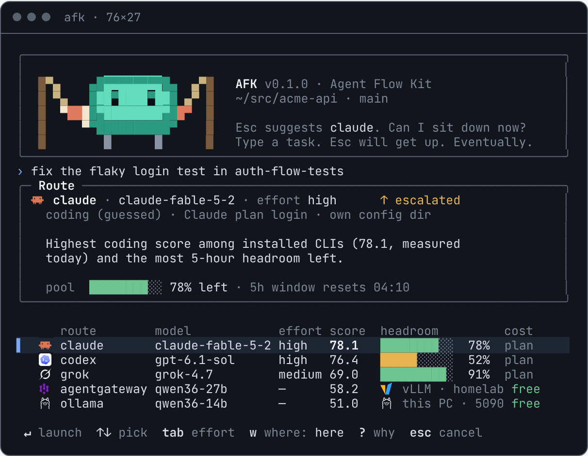
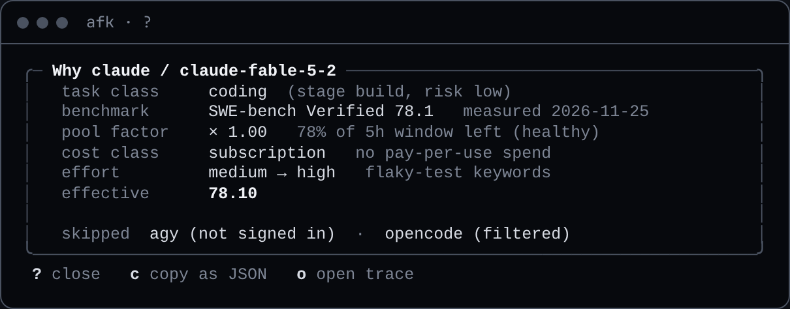

# The route card

Run `afk` on its own and Esc shuffles in and climbs into its hammock (about two seconds; any key skips it, and what you type is kept). Then the composer opens: an input bar for the task, a status line with the prefer mode, the task kind and every route's headroom, and a hint line. In the composer:

| Key | Does |
|---|---|
| `↵` | route the task and run it here, inside AFK (an empty one opens the route card for a CLI without a prompt) |
| `ctrl+o` | the route card for this task: pick the CLI, model and effort, then open the CLI's own screen |
| `tab` / `shift+tab` | step the task kind: auto, coding, quick, complex, review, architecture, webdev, research, security |
| `/harness <cli>`, `/model <id>`, `/effort <level>`, `/prefer balanced\|cheap\|best` | pin a choice (no argument unpins it); `/clear` unpins all |
| `/mode read-only\|ask\|edits\|auto` | the [permission mode](permissions.md) for the rest of this AFK session (no argument: your configured default) |
| `/rate 1\|2\|3` | rate the last run: solved, partly, wrong pick |
| `/open` | reopen the last run's session in its CLI's own screen; exit the CLI to come back |
| `?` | shortcuts (on an empty input) |
| `2`–`7`, `/harnesses`, `/bench`, `/skills`, `/mcp`, `/runs`, `/config` | open the [control panel](control-panel.md) on that tab (the digits on an empty input) |
| `esc` | clear the input |
| `ctrl+c` | clear the input; on an empty input press it twice to exit AFK |
| `ctrl+d` | exit AFK (on an empty input) |

## Running a task here

`↵` is the everyday way to work: AFK routes the task, runs the chosen CLI without its own screen, and prints the answer under your prompt, then the input is ready for the next task, which is routed again.

```text
› what does internal/router/select.go do?
▸ codex · gpt-6.1-sol · medium · ran here                run r-401d

It scores every candidate route for a task and …

  ✓ codex exited 0 · 41s · pool 62% → 60% · 0 files changed
```

- While it runs, a line says which route is working and for how long. `esc` or `ctrl+c` stops the turn. AFK stays open.
- It runs as [`afk -p`](print-mode.md) does: if the CLI can't start or hits a sign-in, quota or rate limit, the next best route answers, and a line says so. `route.failover` limits where a failed turn may go.
- Every turn is saved as a [run](runs.md). `/rate` rates the last one.
- A turn runs the CLI headless: it answers and exits, and nothing is left running or watched in the background. To see what it did, or to carry on in the CLI itself, type `/open`. AFK kept the session id the CLI reported (Codex's `thread_id`, Claude Code's `session_id`) and hands the terminal to `codex resume <id>`, `claude --resume <id>`, `grok --resume <id>` or `agy --resume <id>`. The CLI opens with its own defaults for permissions. When you exit it you are back in AFK. If the CLI reported no session id, `/open` says so; a gateway or local run can't be reopened yet.
- A CLI running this way can't stop to ask you to approve an edit. It runs in your permission mode, and a CLI that can't honour that mode without asking runs in a stricter one and says so (Codex in `ask` runs read-only). Use `/mode edits` to let turns edit files, or `ctrl+o` to work in the CLI's own screen when you want to approve steps one by one.
- Each turn is on its own for now: a follow-up doesn't yet carry the earlier turns along.

## Opening the CLI

`ctrl+o` shows the route card (below) and `↵` there hands the terminal to the CLI. AFK stays open behind it. When the CLI ends, however it ends, AFK prints the receipt, asks for a rating and brings the composer back. Inside the CLI, `ctrl+c` belongs to the CLI: it never closes AFK. Pins set with the slash commands are kept between prompts.

While AFK routes (when it takes more than a moment), Esc gets up and the routing screen lists every candidate CLI: each one ticks off with its model and benchmark score once it is scored, or says it has no usable route for the task.

Run `afk` with a prompt and AFK skips the composer and shows the route card before anything starts:

```sh
afk "make the settings page responsive"
```

<p align="center"></p>

Above the card is the header: Esc, AFK's mascot, standing in front of its hammock, with the AFK version, the folder and git branch, and a status line. Esc gets up while AFK routes, suggests the router's pick on the card, and needs you when a launch fails. Below 70 columns the header is left out, and with `NO_COLOR` it shows the text without Esc.

The top box is the pick: the CLI, model and effort, the kind of task (and whether AFK guessed it), why this route, and how much of its pool is left in the current window (five hours, or a week when that is what the CLI reports; the reset shows its day when it is more than a day away). Below it is the best route on every other installed CLI, with its model, effort, score, pool headroom and cost, then the model gateway and each [local engine](local-models.md) as rows of their own (a local row's headroom column says `this PC` and its GPU).

## Keys

| Key | Does |
|---|---|
| `↵` | start the selected route |
| `↑` `↓` or `j` `k` | pick another row |
| `tab` | step through the effort levels that CLI accepts |
| `e` | edit the prompt; `↵` routes it again, `esc` goes back |
| `y` `y` | yolo: the CLI acts without asking (press twice; a red tag shows it is on, `y` again turns it off). Only in a [trusted](permissions.md#yolo-stays-deliberate) git repository; an interactive OpenCode session keeps its own prompts. The box shows the [permission mode](permissions.md) when it isn't `ask`, and a line when the selected CLI runs a stricter one |
| `?` | the Why panel; `?` again closes it |
| `esc` or `ctrl+c` | cancel; nothing is started. From the composer you go back to it with the prompt still in the input; with `afk "prompt"` AFK exits with code 130 |

`w` (where to run) only offers this terminal for now, and says so when pressed.

`-y` or `--yes` skips the card and starts the router's pick. It is the one-shot form: when the CLI ends, AFK exits with the CLI's exit code.

## The Why panel

`?` shows the reasoning behind the selected row:

<p align="center"></p>

- **task class**: the benchmark class the task is scored on, with the stage and risk it came from
- **benchmark**: the score used and its basis: `measured` (read from a public board), `capped`, `estimate` (a catalog figure) or `stale` (a measurement older than two weeks)
- **pool factor**: how much of the pool's window (5h or weekly) is left, and the pool state
- **pool figure**: how that figure was found: `measured (last -p)`, `measured` or `failed run` (a pool nothing reported says `usage unknown` and has no figure)
- **pacing**: for a measured plan window, where it is heading at the rate so far (left unused at the reset, or running out before it) and what [plan pacing](routing.md#plan-pacing) did to the score; `not applied` when `route.pacing` is off
- **cost class**: subscription, free, local or metered
- **effort**: the effort and, when it was raised, why
- **effective**: the final score the routes are ranked by

## When a route can't start

If the chosen route can't be launched (for example a gateway route with no key set), the card says why. `r` retries, `↵` starts the next best route when there is one, `esc` cancels. If routing itself fails or times out, `r` routes again.

## During the session

Just before the CLI starts, AFK prints the launch line and Esc's empty hammock ("Esc is afk. claude has the terminal."); nothing is animated here, so the CLI starts at once. The chosen CLI runs as a child of `afk` and owns the terminal: you are in its own interface, with nothing wrapped around it. AFK waits until it exits.

## The receipt

When the CLI exits, Esc shuffles back in from the right and climbs into the hammock (about two seconds, while AFK reads pool usage and git; any key brings it home at once), then the receipt shows. Below 76 columns or with `NO_COLOR` there is no Esc, just the receipt:

<p align="center"></p>

- exit status and how long the session took
- the pool's headroom before and after
- files changed and commits, when you were in a git repository

Values AFK can't know show as `n/e`, never as zero. Then it asks how it went: `1` solved, `2` partly, `3` wrong pick, `↵` to skip. The answer is saved with the [run record](runs.md).

## Narrow and plain terminals

Below 40 columns, or with `TERM=dumb`, there is no card: AFK prints one line with its pick and starts it, then a plain receipt and the rating question. Without a terminal at all (a pipe, a redirect or a script), it starts the pick the same way, prints the receipt to stderr, and never waits for a rating; the run is saved without one.

Colour and animation follow your terminal: `NO_COLOR`, `TERM=dumb` or `AFK_MOTION=off` turn animation off, and over SSH the card redraws less often.

## Logos

Each route shows its CLI's logo, drawn the best way the terminal allows:

- **kitty and Ghostty:** small images, sent once with the kitty graphics protocol and drawn with its Unicode placeholders.
- **kitty or Ghostty inside tmux:** the same images, if tmux passes them through. That needs `set -g allow-passthrough on` and 24-bit colour (`set -as terminal-features ',*:RGB'`). If either is missing, AFK says so once and draws pixel marks.
- **iTerm2 and WezTerm:** the same images, as iTerm2 inline images.
- **Terminals that draw Sixel** (foot, Windows Terminal, Konsole, xterm with Sixel, mlterm and others): the same images, as Sixel. AFK asks the terminal when it starts, and uses Sixel only when the terminal says it draws it. The size of a cell comes from the terminal's answer, or else from the window size the terminal reports to the system. xterm draws Sixel only when started as a VT340 (`xterm -ti vt340`, or `XTerm*decTerminalID: vt340`).
- **Every other terminal with colour, and tmux:** a pixel mark, the same logo cut down to two cells of block characters in its own colours.
- **`NO_COLOR`, and logos too thin to make a mark** (grok, ollama, opencode, pi): a two-letter tag in the CLI's colour (`CL` claude, `CX` codex, `GK` grok, `GW` a gateway).

Bubble Tea's renderer can't carry iTerm2 or Sixel images, so AFK draws them over the pixel marks a moment after each frame. A logo the images can't safely reach, such as one on the bottom row or one after you resize the window during the route card, stays a pixel mark.

Set `AFK_LOGOS=text`, `pixel`, `kitty`, `iterm` or `sixel` to choose one yourself.
