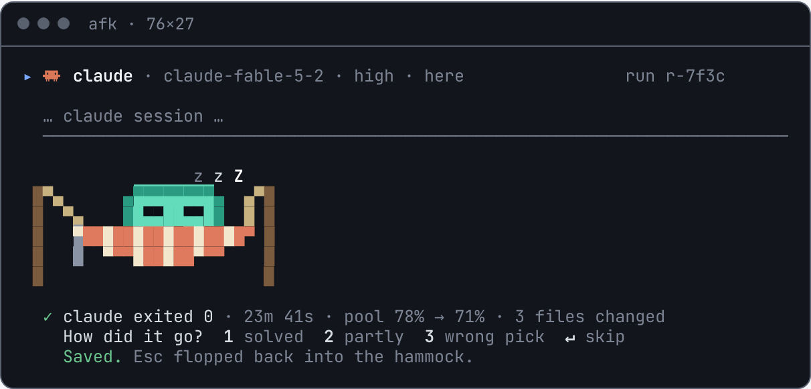

# The route card

Run `afk` with a prompt at a terminal and AFK shows the route card before anything starts:

```sh
afk "make the settings page responsive"
```

<p align="center"></p>

Above the card is the header: Esc, AFK's mascot, standing in front of its hammock, with the AFK version, the folder and git branch, and a status line. Esc gets up while AFK routes, suggests the router's pick on the card, and needs you when a launch fails. Below 70 columns the header is left out, and with `NO_COLOR` it shows the text without Esc.

The top box is the pick: the CLI, model and effort, the kind of task (and whether AFK guessed it), why this route, and how much of its pool is left in the current window (five hours, or a week when that is what the CLI reports; the reset shows its day when it is more than a day away). Below it is the best route on every other installed CLI, with its model, effort, score, pool headroom and cost.

## Keys

| Key | Does |
|---|---|
| `↵` | start the selected route |
| `↑` `↓` or `j` `k` | pick another row |
| `tab` | step through the effort levels that CLI accepts |
| `e` | edit the prompt; `↵` routes it again, `esc` goes back |
| `y` `y` | yolo: the CLI acts without asking (press twice; a red tag shows it is on, `y` again turns it off). Only in a [trusted](permissions.md#yolo-stays-deliberate) git repository; an interactive OpenCode session keeps its own prompts. The box shows the [permission mode](permissions.md) when it isn't `ask`, and a line when the selected CLI runs a stricter one |
| `?` | the Why panel; `?` again closes it |
| `esc` or `ctrl+c` | cancel; nothing is started (exit code 130) |

`w` (where to run) only offers this terminal for now, and says so when pressed.

`-y` or `--yes` skips the card and starts the router's pick.

## The Why panel

`?` shows the reasoning behind the selected row:

<p align="center"></p>

- **task class**: the benchmark class the task is scored on, with the stage and risk it came from
- **benchmark**: the score used and its basis: `measured` (read from a public board), `capped`, `estimate` (a catalog figure) or `stale` (a measurement older than two weeks)
- **pool factor**: how much of the pool's window (5h or weekly) is left, and the pool state
- **pool figure**: how that figure was found: `measured (last -p)`, `measured`, `estimated` or `failed run`
- **pacing**: for a measured plan window, where it is heading at the rate so far (left unused at the reset, or running out before it) and what [plan pacing](routing.md#plan-pacing) did to the score; `not applied` when `route.pacing` is off
- **cost class**: subscription, free, local or metered
- **effort**: the effort and, when it was raised, why
- **effective**: the final score the routes are ranked by

## When a route can't start

If the chosen route can't be launched (for example a gateway route with no key set), the card says why. `r` retries, `↵` starts the next best route when there is one, `esc` cancels. If routing itself fails or times out, `r` routes again.

## During the session

Just before the CLI starts, AFK prints the launch line and Esc's empty hammock ("Esc is afk. claude has the terminal."); nothing is animated here, so the CLI starts at once. The chosen CLI runs as a child of `afk` and owns the terminal: you are in its own interface, with nothing wrapped around it. AFK waits until it exits.

## The receipt

When the CLI exits, Esc shuffles back in from the right and climbs into the hammock (about two seconds, while AFK reads pool usage and git; any key brings it home at once), then the receipt shows. Below 76 columns or with `NO_COLOR` there is no Esc, just the receipt:

<p align="center"></p>

- exit status and how long the session took
- the pool's headroom before and after
- files changed and commits, when you were in a git repository

Values AFK can't know show as `n/e`, never as zero. Then it asks how it went: `1` solved, `2` partly, `3` wrong pick, `↵` to skip. The answer is saved with the [run record](runs.md).

## Narrow and plain terminals

Below 40 columns, or with `TERM=dumb`, there is no card: AFK prints one line with its pick and starts it, then a plain receipt and the rating question. Without a terminal at all (a pipe, a redirect or a script), it starts the pick the same way, prints the receipt to stderr, and never waits for a rating; the run is saved without one.

Colour and animation follow your terminal: `NO_COLOR`, `TERM=dumb` or `AFK_MOTION=off` turn animation off, and over SSH the card redraws less often.

## Logos

Each route shows its CLI's logo. In kitty and Ghostty the logos are small images (sent once with the kitty graphics protocol and drawn with its Unicode placeholders). Other terminals, tmux, and `NO_COLOR` show a two-letter tag in the CLI's colour instead (`CL` claude, `CX` codex, `GK` grok, `GW` a gateway). Set `AFK_LOGOS=text` to always use the tags, or `AFK_LOGOS=kitty` to force images in a terminal AFK doesn't recognise.
